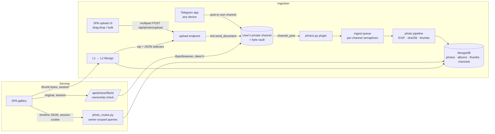

# TeleDirect Photos — Implementation Plan & Architecture

A Google Photos-style variant of TeleDirect: signed-in users back up photos/videos
to **their own private Telegram channel** (bot as admin), browsable as a timeline
gallery in the existing React SPA. Originals stream on demand from Telegram via the
existing MTProto bridge; we never persist user bytes to disk.

Reference product: [Telephoto](https://github.com/ASRumon/Telephoto) — validates the
model (Telegram-as-storage, timeline UI, backup semantics). Our variant is
server-side MTProto (original-quality bytes, large-file support) with a web UI,
reusing this repo's streaming core.

**Scale assumption: personal use, ≤ 10 users.** Design decisions below are made
under that assumption (see "What small scale simplifies").

---

## 1. Product model

- User signs in with the existing Telegram Login (`td_session` cookie).
- User creates **one private channel**, adds the bot as admin, connects it in the SPA.
- Anything posted to that channel is their library: timeline, albums, favorites,
  search — all served from our metadata + thumbnails; bytes fetched from Telegram
  only when an original is viewed/downloaded.
- **Privacy is a hard requirement**: no user can ever read another user's metadata,
  thumbnails, or bytes. Every read is scoped server-side by session user.

### Brand name

Working pick: **Darkroom** (`teledirect/darkroom`, "Your Darkroom" in the UI) —
the privacy connotation is exactly the pitch. Alternatives: **Stillwater**
(strongest standalone brand), **Lightwell**, **Filmroll**. Avoid "gram" puns
(trademark-adjacent).

---

## 2. Key decisions

### 2.1 Module in this repo/process — NOT a separate microservice

| Option | Verdict |
|---|---|
| Module in this repo/process (new plugin + route table + SPA section) | **Yes** |
| Separate microservice | No |

- The expensive, stateful asset is the Pyrogram client pool + `ByteStreamer`
  media sessions (`main/bot/clients.py`, `main/utils/custom_dl.py`). A second
  service would duplicate Telegram sessions and FloodWait budgets, or RPC into
  this one for every byte.
- The established extension pattern here is per-domain modules:
  `iptv_routes.py`, `hub_routes.py`, `watchlist_routes.py`, plugins dir.
  Photos is one more domain.
- Multi-user isolation is a **data-model property** (`owner_user_id` on every
  doc + session-scoped queries), not a deployment property.
- The only piece that might deserve extraction later is CPU-heavy thumbnail
  generation. Build the pipeline as a queue-fed worker coroutine from day one
  so extraction (behind a job queue) is mechanical if profiling ever demands it.

### 2.2 One channel per user; albums as metadata — NOT channel-per-album

| | One channel + metadata albums | Channel per album |
|---|---|---|
| Onboarding friction | Create 1 channel, add bot once | N channels, N connect/verify flows |
| Photo in 2 albums | Free (`album_ids: […]`) | Duplicate upload — double storage |
| Move between albums | One Mongo update | Re-upload / bot-side copy (new `message_id`) |
| Timeline view | One query on `taken_at` | Merge-sort across N channels + dedup |
| Favorites / smart views | Same mechanism as albums | Needs a second system anyway |
| Delete album | Mongo-only, bytes untouched | Delete a whole channel |
| Visible in Telegram app | One "Library" channel | Native per-album browsing (the only real win — but the SPA is our browsing surface) |

The channel is a **dumb, durable byte vault**. Grouping is a query concern.

### 2.3 Send/store as document (original bytes), not Telegram "photo"

Telegram recompresses photo messages. A Google Photos alternative must store
original bytes. Cost: no server-side Telegram thumbnail → we generate our own at
ingest (Pillow for images, ffmpeg poster frame for videos).

### 2.4 Thumbnails at ingest, not on-demand

Grid scrolling needs hundreds of thumbs instantly; lazy generation from Telegram
would FloodWait the pool. Generate 2 sizes at ingest (grid ~400px webp, preview
~1600px webp) and persist to Mongo (the `thumb_cache` L2 pattern). Originals are
never re-downloaded for browsing.

### 2.5 Single-owner-channel trust model

Registration requires proof the requester controls the channel (see §4). This is
the entire privacy story and is built first.

---

## 3. Reuse map

| Need | Existing asset |
|---|---|
| Byte delivery w/ Range support | `main/utils/custom_dl.py` `ByteStreamer`, `main/server/stream_routes.py` |
| URL/file identity | `gen_link()` / `file_properties.py`, `unique_id[:6]` hash scheme |
| Persistence pattern | `main/utils/store.py` `MongoStore` write-through + `from_env()` |
| Thumbnail caching | `main/utils/thumb_cache.py` (L1 mem + L2 Mongo, per-key lock) |
| Web auth | Telegram Login → session cookie (`auth_routes.py`, `user_auth.py`) |
| Ingestion shape | `main/bot/plugins/stream.py` (mirror its structure) |
| API surface pattern | per-domain aiohttp `RouteTableDef` registered in `main/server/__init__.py` |
| Media processing | `ffmpeg`/`ffprobe` already in the Docker image |
| Dedup primitive | `main/utils/dedup.py` (sha256 approach) |

Gaps to build: EXIF extraction, photo thumbnail generation, timeline/album data
model, per-user scoping, gallery UI.

---

## 4. Connect & trust flow (privacy linchpin)

```
User creates private channel → adds bot as admin
SPA "Connect" → POST /api/photos/connect {channel: @name or -100… id}
Bot verifies:
  1. getChat(channel)            — bot is admin with post/delete rights
  2. getChatMember(channel, session.user_id)
                                  — requester is creator/administrator
  3. channel not already bound to another user_id
→ photo_channels.insert {channel_id, owner_user_id, creator_user_id,
                         linked_at, status: active}
```

- Step 2 is the trust boundary: the requester must provably control the channel.
- Store `creator_user_id` at connect; periodic re-verify + `ChatMemberUpdated`
  handling. Bot kicked or user loses admin → `status: disconnected`: originals
  unfetchable, thumbs still served with a UI banner. Channel creator changed →
  freeze + alert (channel-ownership transfer would silently re-bind a library).
- At ≤10 users the flow is explicit and unfancy: paste link/ID, verify, done.

---

## 5. Data model (MongoDB; every doc carries `owner_user_id`)

```json
photos: {
  "owner_user_id": 123,
  "channel_id": -100…, "message_id": 456, "unique_hash": "ab12cd",
  "kind": "image|video",
  "file_name": "IMG_2041.HEIC", "mime": "image/heic", "size": 4200110,
  "width": 4032, "height": 3024, "duration": null,
  "taken_at": "2026-09-21T14:03:11Z",   // EXIF DateTimeOriginal, fallback: upload time
  "camera": "Apple iPhone 15", "gps": {"lat": …, "lon": …},
  "sha256": "…",                         // per-user dedup + backup-sync identity
  "thumb": {"grid": true, "preview": true},
  "favorite": false, "album_ids": ["…"],
  "deleted": false, "uploaded_at": "…"
}

photo_channels: { "channel_id": -100…, "owner_user_id": 123,
                  "creator_user_id": 123, "status": "active|disconnected|frozen",
                  "linked_at": "…" }

photo_albums:   { "owner_user_id": 123, "name": "Portugal 2026",
                  "cover_message_id": 456, "created_at": "…", "sort": 0 }

photo_thumbs:   { "key": "<channel_id>:<message_id>:grid|preview",
                  "owner_user_id": 123, "data": "<Binary webp>" }
```

Indexes:
- `photos`: `(owner_user_id, taken_at desc)`, `(owner_user_id, sha256)` **unique**
  (per-user dedup, idempotent re-backup), `(owner_user_id, favorite)`.
- `photo_channels`: `channel_id` unique, `owner_user_id` unique (one channel per user).
- `photo_thumbs`: `key` unique.

Albums are pure metadata: create/rename/delete are Mongo-only ops (delete = pull
`album_id` from member docs; channel bytes untouched). Timeline, favorites, and
albums are three lenses over the same `photos` collection.

---

## 6. Architecture



### Backend modules (new, `main/`)

| Module | Responsibility |
|---|---|
| `main/bot/plugins/photos.py` | `channel_post` handler for any channel in `photo_channels` (dynamic lookup); enqueue pipeline |
| `main/utils/photo_pipeline.py` | Probe (dimensions/duration via ffprobe), EXIF (`piexif`, `pillow-heif` for HEIC), sha256 (dedup check first), thumb gen (Pillow webp 400px + 1600px; ffmpeg poster for video) |
| `main/utils/photo_store.py` | Motor-backed store: upsert, timeline cursor pagination, album CRUD, favorites, soft-delete (trash → delayed channel delete) |
| `main/server/photo_routes.py` | Connect/disconnect/status; `GET /api/photos/timeline?cursor=` (day-grouped); `GET /api/photos/thumb/{id}/{size}`; `GET /api/photos/{id}`; favorite toggle; albums CRUD + bulk add; trash/restore; `GET /api/photos/file/{message_id}` (ownership-checked byte stream w/ Range); `POST /api/photos/upload` (multipart → bot `send_document` into the user's channel) |
| `main/vars.py` | `PHOTOS_ENABLED`, `PHOTO_THUMB_SIZES`, `PHOTOS_PER_USER_CAP` (runaway guard, e.g. 50000) |

### Frontend (`frontend/src/`)

| Piece | Notes |
|---|---|
| `components/photos/connectPage.tsx` | Empty-state wizard: create channel → add bot → paste link → verified |
| `components/photos/timelinePage.tsx` | Virtualized day-grouped grid, date scrubber |
| `components/photos/lightbox.tsx` | Preview webp → original via `/api/photos/file/{id}`; video via existing player path |
| `components/photos/albumsPage.tsx` | Album grid, album detail, add-to-album bulk action |
| `components/photos/uploadZone.tsx` | Drag-drop + multi-file picker, client-side queue with progress/resume; drop onto an album view tags uploads with that album |
| `api.ts` / `types.ts` additions | `Photo`, `Album`, `ChannelStatus` types |

### Ingestion paths

All three paths converge on **one pipeline** — the channel is always the byte
vault, `channel_post` always triggers the same EXIF/sha256/thumb pipeline, and
`(owner_user_id, sha256)` dedup makes every path idempotent:

1. **Telegram-native backup.** Post/auto-forward photos to your channel from any
   Telegram client — the mobile backup story, no app needed.
2. **Web UI upload.** Drag-drop/multi-select in the SPA →
   `POST /api/photos/upload` (multipart, per-file progress) → server streams the
   file to Telegram via the bot's `send_document` into the user's own channel.
   Nothing touches disk beyond the request buffer; the resulting `channel_post`
   is ingested like any other post. Optional `album_id` field tags the upload.
   Limits: per-request file count + total size caps, sequential send to respect
   FloodWait; client-side queue keeps bulk uploads resumable.
3. **Google Photos migration (future, §8a).** Takeout import funnels through the
   same upload endpoint so dedup, thumbs, and albums behave identically.

Originals are never on our disk; thumbs + metadata in Mongo are rebuildable from
the channel alone.

---

## 7. Serving path & security

The existing `/watch/{hash}{id}` stream URLs are **bearer-by-hash** — fine for a
movie catalogue, unacceptable for personal photos.

- Gallery data + thumbs: session cookie required; every query filtered by
  `owner_user_id` server-side. Thumbs served from L1/L2 — no Telegram hit.
- Originals: `GET /api/photos/file/{message_id}` — resolve session → user, assert
  a `photos` doc exists with that `message_id` **and**
  `owner_user_id == session user`, then stream via `ByteStreamer` (client 0)
  with Range support (video scrubbing).
- The photos plugin never emits public hash links.
- Sharing (optional, later): per-album signed HMAC tokens, expiring, explicitly
  opt-in per share.

---

## 8. What small scale (≤10 users) simplifies

- **No worker-bot auto-invite.** All photo bytes stream through client 0; original
  fetches are rare (thumbs cover browsing). Multi-client pool stays untouched for
  catalogue traffic. Removes the shakiest connect step (bot-inviting-bots).
- **Quotas are a guardrail, not a product limit** — `PHOTOS_PER_USER_CAP` env,
  generous default, purely to catch runaway loops.
- **Connect flow stays manual and explicit** — no auto-discovery heuristics.
- **Full `owner_user_id` scoping regardless** — ten friends is exactly the group
  that will probe each other's URLs; the isolation code is the same either way.

---

## 9. Google Photos migration (future)

Goal: a user leaving Google Photos lands their whole library — **with dates and
albums intact** — in their Darkroom channel.

**Source: Google Takeout** (export → "Google Photos" → zip archives). Takeout
ships each media file beside a JSON sidecar carrying the metadata Google strips
from recompressed files: `photoTakenTime.timestamp`, `creationTime`, geo data,
and per-archive folder names = the user's Google albums. No OAuth/API surface
needed, no Google approval process, works with the free tier.

**Flow:**

1. SPA "Import from Google Photos": user uploads Takeout zips (or selects them
   via file picker — client-side `zip.js` can stream entries without a giant
   multipart).
2. Importer walks each archive, pairs media with its sidecar, and for every item:
   - sha256 → **skip if already in library** (dedup makes re-runs safe after a
     partial import).
   - Post bytes to the user's channel via the same path as `/api/photos/upload`.
   - Carry `taken_at` from `photoTakenTime` (authoritative over EXIF — Google
     preserves edit/export timestamps there) and map the Takeout folder name →
     `photo_albums` entry, created on first sight.
3. Progress doc in Mongo (`import_jobs`: done/total/current file) so the UI can
   show a resumable progress bar; job survives restarts by re-checking sha256.

**Caveats to surface in the UI:**

- Takeout caps archives at 50 GB; large libraries arrive as many zips — accept
  multiple files and process sequentially.
- Edited photos export as both original and `-edited` copy; import both, EXIF
  dates usually match, user can trash either.
- Live Photos arrive as image + paired `.mp4`; import both, link later if we
  ever render motion photos.
- Throughput is FloodWait-bound, not bandwidth-bound: this is an overnight job
  for a 20k-photo library, and the progress/resume design assumes that.

**Effort**: ~2–3 days when scheduled (zip walking + sidecar parsing + job doc +
progress UI). Zero new infrastructure — it reuses the upload path, the pipeline,
and dedup.

---

## 10. Phases

| Phase | Scope | Verify |
|---|---|---|
| **P0 — Foundations** (½d) | env vars, deps (`piexif`, `pillow-heif`), `photo_channels` store | boots, store round-trips |
| **P1 — Connect flow** (1d) | `/api/photos/connect|disconnect|status`, admin + creator verification, disconnect/frozen detection | negative tests: non-admin requester, channel bound to another user, bot-kicked |
| **P2 — Ingestion + pipeline** (2–3d) | channel_post plugin, EXIF/sha256/thumbs, per-user store, dedup, per-channel queue | post ~50 mixed photos/videos → docs + thumbs in Mongo; resend dedups; FloodWait-safe |
| **P3 — Session-guarded API + delivery + upload** (2d) | timeline/albums/favorites/trash routes, albums CRUD, authenticated byte route, `POST /api/photos/upload` | negative test: user B's session cannot fetch user A's thumb, metadata, bytes, or upload into A's channel |
| **P4 — Gallery UI** (3–4d) | connect wizard → timeline grid → lightbox → albums → upload dropzone with queue/progress | `npm run build`, vitest, browser walkthrough incl. drag-drop upload landing in timeline |
| **P5 — Ops + differentiators** (each ships independently) | wipe-library (bot deletes channel messages), metadata export; then memories (on-this-day via `taken_at` index), map view from GPS EXIF, OCR search | per-feature |
| **P6 — Google Photos migration** (2–3d, when scheduled) | Takeout zip import: sidecar parsing, folder→album mapping, resumable `import_jobs` progress | import a real Takeout sample: dates preserved, albums recreated, re-run dedups |

Explicitly out of scope: Telephoto's notes/LaTeX/AI surface (separate product),
multi-user shared libraries, native mobile apps, face clustering (heaviest;
revisit only if wanted).

---

## 11. Risks

| Risk | Mitigation |
|---|---|
| Channel ownership transfer silently re-binds a library | Store `creator_user_id` at connect; periodic re-verify; freeze + alert on mismatch |
| User kicks bot / deletes channel | `status: disconnected`; originals 410 gracefully, thumbs still served; reconnect flow |
| Mass `channel_post` bursts (initial 10k-photo dump) | Per-channel queue + semaphore + FloodWait backoff; CPU-bound thumb gen capped by semaphore |
| Web upload amplifies bursts | Upload endpoint sends sequentially into the same per-channel queue; client-side queue with resume |
| Takeout import of a huge library runs for hours | Resumable `import_jobs` doc; sha256 skip makes restarts free; sequential FloodWait-safe pacing |
| Thumb storage growth in Mongo | ~15–40 KB per grid webp; 10k photos ≈ 0.5 GB across two sizes — fine; originals never in Mongo |
| HEIC/RAW not renderable in browsers | Lightbox serves preview webp; original exposed as download only (same trade Telephoto makes) |
| Bearer-hash URL leakage | Photos never use the public route; session-checked delivery only |
| Telegram as sole byte storage | Metadata export endpoint (P5); library re-indexable from channel alone |

---

## 12. First executable slice

**P0 + P1** — vars, `photo_channels` store, connect endpoint with negative tests.
Everything else hangs off `owner_user_id` being trustworthy.

---

## 13. Status & next phase (2026-09-27)

**Delivered:** P0–P4 plus hardening — connect/disconnect/reverify/freeze,
pending-channel auto-link, `/api/photos/resync` with scan record in `/status`,
EXIF/GPS/camera/sha256 pipeline, two webp thumbs with coalesced regen + failure
backoff, timeline/favorites/trash/albums API, ownership-checked byte streaming,
multipart upload, and the GPhotos-grade SPA (virtualized timeline, scrubber,
selection, YARL lightbox, albums, dropzone, info drawer).

**Next phase scope (decided):** trash purge, wipe + export, memories, map view,
Google Takeout import. **Deferred:** album sharing (HMAC links), OCR search —
both revisit after this phase.

### N1 — Trash purge (½d) — first, N2 builds on it

- `POST /api/photos/trash/empty`: batch `delete_messages(channel_id, ids)`
  (Telegram cap 100/batch) for `deleted: true` docs; only remove Mongo docs +
  thumbs for messages confirmed deleted; report skipped/failed counts.
- UI: "Empty trash" with count + confirm; trash view gains age display.

### N2 — Wipe-library + metadata export (1d)

- `POST /api/photos/wipe {confirm: "<channel title>"}`: reuses the N1
  batch-delete primitive across the whole library, then drops the user's
  photos/thumbs/albums docs; channel doc survives with `status: active` so the
  vault can be refilled.
- `GET /api/photos/export`: streaming JSON (photos incl. taken_at/gps/camera/
  sha256/album membership, albums) — the answer to "Telegram as sole byte
  storage" (§11); shape chosen to be re-importable by N5's importer.

### N3 — Memories / on-this-day (½d)

- Store `taken_md: "MM-DD"` at ingest + backfill migration; index
  `(owner_user_id, taken_md)`. `GET /api/photos/memories` matches today's
  `MM-DD` across years, `deleted: false`. UI: card strip above the timeline.
- Pure read-side: `taken_at` already indexed; the `MM-DD` field exists only to
  keep the query indexable (a `$expr $month/$dayOfMonth` scan per request is
  fine at ≤10 users but the field is cheaper and trivial).

### N4 — Map view (1d)

- `GET /api/photos/map-points` → `[{photoId, lat, lon}]` for docs with `gps`
  (field already populated at ingest).
- UI: Leaflet + OpenStreetMap tiles (adds `leaflet`/`react-leaflet` deps);
  client-side clustering (supercluster) — point counts per user are small.
  Click cluster/photo → lightbox.
- Privacy note for the UI: third-party tiles leak the rough viewport to the
  tile host; acceptable at this scale, disclosed in the empty state.

### N5 — Google Takeout import (2–3d) — per §9, concretized

- Client: `zip.js` streams Takeout zip entries in-browser; each media file is
  POSTed to the existing `/api/photos/upload` with two new optional fields:
  `taken_at` (sidecar `photoTakenTime.timestamp`, authoritative over EXIF) and
  `album_name` (Takeout folder → create-or-get `photo_albums` by name, since
  the upload endpoint currently takes `album_id` only).
- Server: upload endpoint honors the two fields; pipeline trusts provided
  `taken_at` over EXIF but still stores EXIF when absent.
- `import_jobs` Mongo doc (done/total/current/started_at) per user so the UI
  shows a resumable progress bar; sha256 dedup makes restarts and re-runs free.
- UI: "Import from Google Photos" wizard (pick zips → progress → summary of
  imported/skipped/failed), caveats from §9 surfaced (50 GB archive cap,
  `-edited` copies, Live Photo pairs imported as separate items).

### Sequencing rationale

N1→N2 (shared batch-delete primitive), N3 (cheapest visible win), N4
(independent, UI-heavy), N5 last and largest — it benefits from N2's export
shape existing as its counterpart, and every week it slips costs a migrating
user their unimported library.

### Verification

- Backend: `tests/test_photos.py` conventions — negative tests (user B cannot
  purge/wipe/export user A; wipe without confirm rejected), batch-delete
  partial-failure accounting, memories date-matching across years, map-points
  excludes non-GPS/deleted docs, Takeout sidecar parsing + `taken_at`
  precedence + folder→album mapping + re-run dedup.
- Frontend: vitest for new components; `npm run build`; browser walkthrough of
  empty-trash, export download, memories strip, map clustering, and a real
  Takeout sample import.

---

## 14. Road to "recommended as a Google Photos alternative" (waves, 2026-09-27)

Target state: a reviewer comparing us against Immich/PhotoPrism/Ente can check
every mainstream row, and the rows we deliberately skip are stated trades, not
gaps. Sources: 2026 comparisons (Contabo, sumguy.com, stackpicks.dev) — the
recurring checklist is: **mobile backup · timeline · smart search · faces ·
map · memories · sharing · Takeout import · trash · video playback · RAW ·
storage/export story**.

### Parity scorecard (reviewer checklist vs. today)

| Reviewer row | Status |
|---|---|
| Timeline w/ scrubber, favorites, albums, trash, video playback, dedup | ✅ shipped (P0–P4) |
| Original-quality storage, no storage bill | ✅ shipped — our differentiator (Telegram vault) |
| Takeout import · map view · memories · export · wipe | 🔲 Wave A (decided, N1–N5) |
| Search (metadata → OCR → semantic) | 🔲 Wave B |
| Face recognition | 🔲 Wave B, decision point |
| Sharing (album links) | 🔲 Wave C |
| Mobile backup | 🔲 Wave D — conscious trade, see below |
| Non-destructive edit, near-dupes, RAW, integrity | 🔲 Wave E |
| Productization (pitch, docs, demo) | 🔲 Wave F |
| E2E encryption | ❌ out — Telegram is the trust boundary; say so |
| Partner/shared libraries | ❌ out — single-owner data model (§2.2) |

**Mobile backup honesty:** every comparison leads with native auto-backup
apps. Ours is a *web* app by design (§10). The pitch: the Telegram app on
every phone **is** the backup client — auto-send/forward to your channel, no
new app, no background-service battery fight. Wave D makes that flow
first-class (share target, coaching, confirmation) rather than pretending to
be a native app.

### Wave A — Trustworthy home (5–6d) — decided, N1–N5

Trash purge → wipe + export → memories → map → Takeout import (§13). After
this wave: a GPhotos refugee can migrate everything and lose nothing.

### Wave B — Find anything (3–6d, two decision points)

| Item | Effort | Notes |
|---|---|---|
| B1 metadata search bar | ½–1d | Filename, camera, date range, kind, album — one `/api/photos/search` endpoint, Mongo filters; search box in timeline header |
| B2 OCR text search | 1–2d | Pulls in the deferred P5 item: tesseract on preview webps in the ingest queue (bg, low priority), `photos.ocr_text` field, search falls through to it. "Find the receipt/boarding pass" query |
| B3 semantic search (CLIP) | 2–3d | **Decided 2026-09-27: Atlas `$vectorSearch`, not in-process numpy.** MobileCLIP-S0 (512-dim) via onnxruntime on the preview webp at ingest; embedding stored as `clip: {model, v}` on the photos doc (model tag = cheap future reindex path). One vector search index, pre-filtered on `owner_user_id` + `deleted` — owner isolation enforced inside the DB, no per-user embedding caches to invalidate on trash/purge/wipe. Query path: lazy-loaded text encoder → `$vectorSearch`. Atlas-only feature (no `mongot` in self-managed community Mongo) → ships behind `PHOTOS_CLIP`, `/status` reports index presence, UI hides semantic search when absent. Automated Embedding (Voyage) not usable — text-only, we embed images ourselves. Bonus: same Atlas Search infra serves B2 as a Lucene `text` index on `ocr_text`. RAM cost ~1 GB at ingest, ~300 MB query-time text encoder. Verify M0 free-tier search-index limit (believed 3; we need 1) against the live cluster. |
| B4 face recognition | 2–4d | **Decision point, heaviest.** InsightFace/ONNX detect+embed at ingest, cluster per user, People UI. Reviewers treat it as table stakes; plan §10 deferred it. Decide after B3 lands (same ML plumbing) |

B1 alone kills the "can't find anything" objection; B3/B4 are what turns
"alternative" into "replacement" in reviews.

### Wave C — Share it (1½d)

- C1 album sharing: expiring HMAC-signed links (§7 design), read-only page,
  no session needed, revocable. **Decision from 2026-09-27 stands: was
  deferred from the N-phase, lands here.**
- C2 single-photo link: same primitive, one photo.
- Explicitly not: collaborative/shared libraries (single-owner model).

### Wave D — Phone in pocket (2d)

- D1 PWA share target: Web Share Target API on the photos section — phone
  gallery → Share → Darkroom → upload queue. The closest thing to "share
  sheet backup" a PWA gets.
- D2 Backup coaching: connect wizard gains a "set up phone backup" step
  (pin channel in Telegram, forward/auto-send instructions per platform).
- D3 Bot DM confirmation: when a `channel_post` ingests, optional bot reply
  "📸 3 photos backed up" — the reassurance loop native apps provide.

### Wave E — Curate (3d)

- E1 non-destructive rotate/flip: orientation override field, applied at
  thumb/lightbox render; original bytes untouched.
- E2 near-duplicate finder: dHash at ingest (cheap, Pillow), "Duplicates"
  review view. Exact dupes are already impossible (sha256 unique index).
- E3 RAW support: extract embedded JPEG preview for thumbs (exiftool/rawpy);
  original downloadable. Reviewers check the box.
- E4 integrity report: channel-vs-Mongo audit (rescan exists; add a report
  UI + scheduled run — Immich v3 shipped the same idea).

### Wave F — The pitch (1d)

"Recommended" is a content problem as much as a feature problem: README
section + landing page with the scorecard above, privacy model writeup
(session-scoped everything, Telegram as trust boundary), connect-flow
screenshots, honest "what we don't do" list (E2EE, partner sharing, native
apps). This is what a reviewer links to.

### Sequencing & effort

```
A (5–6d) → B1+B2 (2d) → C (1½d) → D (2d) → F (1d)   = recommendable baseline
          ↘ B3 (2–3d, decision) → B4 (2–4d, decision)  = "replacement" tier
          ↘ E (3d) anywhere after B1                   = depth
```

Recommendable baseline ≈ **11–13 days** of work after Wave A. B3/B4 + Wave E
are the delta between "credible alternative" and "what reviewers demo".
